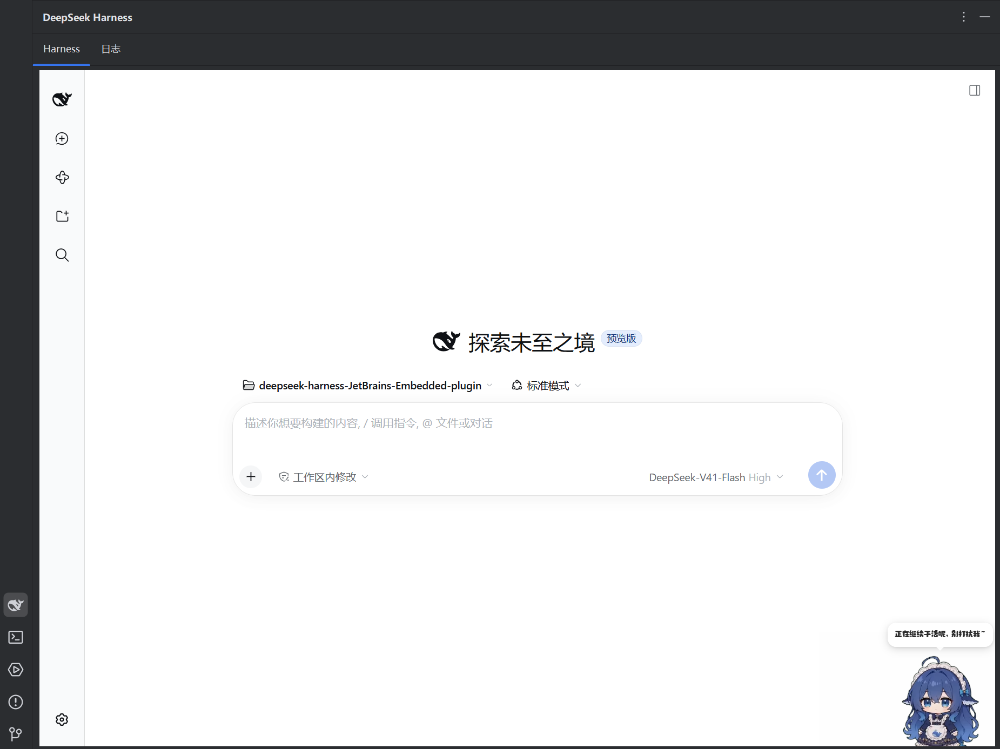

# DeepSeek Harness for JetBrains IDEs

**English** | [中文](README.md)

Use the **DeepSeek Harness** already installed on your machine right inside a JetBrains IDE: click the sidebar icon and the full Harness UI opens in a tool window.



---

## Why I wrote this plugin

I tried the DeepSeek Harness plugins available in the plugin marketplace, and they **never actually worked for me — and configuring them was a pain**.

So I wrote this one. Its logic is **deliberately minimal**: it does exactly three things — detect the `dsh` command, start the local Harness server, and embed that address in the IDE. It does not parse protocols, manage models, or touch your login state. Fewer moving parts means fewer ways to fail, which makes it more usable in practice.

## Prerequisites (read this first)

1. **The DeepSeek Harness desktop app is installed**, and has been launched at least once.
2. **The `dsh` CLI is installed and on your `PATH`.**
   Install it from the desktop app menu: **"应用 (App) → 管理 dsh 命令… (Manage dsh command…)"**.
   Website: <https://harness.deepseek.com>
3. Your IDE supports JCEF (all JetBrains IDEs bundle it; it powers embedded browsers).

> **Mind the `PATH`.** The plugin invokes `cmd.exe /c dsh ...`, which inherits the environment of the IDE process.
> If you installed `dsh` **after** starting your IDE, the IDE cannot see the new `PATH` — **restart the IDE once**.

## What you get

- **Perfectly unified with your system-installed DeepSeek Harness.** The plugin reuses the copy of Harness you already have, so **there is no second configuration**: models, login state, session history and working directory are exactly the ones in your desktop app. It is the same environment from the first click.
- **Nothing to configure inside the plugin.** No path, no port, no token — the plugin starts the server itself and captures the address (token included). If a port is taken, it moves on to the next one.
- **Simple to use.** Install it, click the sidebar icon. No terminal, no typing `dsh web` yourself.
- **Clean.** One `dsh` process per project window, and the whole process tree is terminated with `taskkill /F /T` when the window is released — no orphaned processes, no ports left occupied.
- **Built-in debug log.** The "日志" (Log) tab prints every command executed, its exit code, timings, the raw command output, and the final URL.

## Installation

### From the plugin marketplace

Search for **DeepSeek Harness Embedded** under `Settings → Plugins → Marketplace`.

### From disk

1. Build the zip first (see "Building from source" below).
2. `Settings → Plugins → gear icon ⚙ → Install Plugin from Disk…` and pick that zip.
3. **Restart the IDE.**

## Usage

1. After the restart, a **DeepSeek Harness** icon appears on the right sidebar (the whale among the vertical buttons; its color follows the IDE theme).
2. Click it. The window has two tabs:

   - **Harness** — the main view. The plugin detects `dsh`, starts the local server, and embeds the Harness UI here.
   - **日志 (Log)** — full debug output for the whole flow. **Look here first** when something goes wrong.

3. If no usable `dsh` is found, the Harness tab shows installation instructions and the hint
   "dsh 命令完成后，点击下方刷新按钮" (once the dsh command is ready, click the refresh button below).
   Install `dsh` as instructed, then click **刷新 (Refresh)** — no IDE restart needed.

## Settings

Path: `Settings → Tools → DeepSeek Harness Embedded`.

| Option | Default | Description |
| --- | --- | --- |
| Render the "Harness" and "日志" (Log) tabs above the tool window | On | When checked, the two tabs are shown above the tool window so you can switch between the main view and the debug log. When unchecked the tab bar is not rendered and only the Harness view is shown, giving the tab bar's height back to the content area — useful on short screens or when you do not need the log inside the IDE. The log is still written to the IDE's `idea.log`. Changes take effect immediately, with no IDE restart. |

## How it works

```text
Click the sidebar icon
   │
   ├─ Detect: cmd.exe /c dsh --version          (5 s timeout)
   │     ├─ unavailable ──► show install instructions + Refresh button
   │     └─ available ──► continue
   │
   ├─ Pick a port: first free port in 3080..3100
   │
   ├─ Start: cmd.exe /c dsh web --host 127.0.0.1 --port <port> --no-open
   │         working directory = user home
   │
   ├─ Capture: read its stdout concurrently, match `dsh web: <url>` (token included)  (60 s timeout)
   │
   ├─ Embed: load that URL in a JCEF browser
   │
   └─ Release: on tool window / project close or IDE exit
              taskkill /F /T /PID <pid>   ← terminates the whole process tree
```

A few decisions worth knowing about:

- **Each project window gets its own `dsh` process**; they do not interfere.
- **An already-running server is never reused.** Harness only prints its token on the owning process's own stdout, so it cannot be obtained from outside — the plugin has to spawn the process itself.
- **`taskkill /F /T` is required.** `cmd.exe /c dsh web ...` produces a process tree at least two levels deep (`cmd.exe → DeepSeek Harness.exe`). Killing only the outermost process leaves an orphan holding the port.
- **Reading and waiting must happen concurrently.** On Windows, if the child's stdout is a pipe nobody reads, `cmd.exe` never exits. So output is read while waiting for exit, rather than "wait first, read later".
- **Ports shift automatically when taken**, so an existing `dsh web` instance is unaffected.

## Version requirements

- **IDE 2025.3 (build 253) or newer.** The plugin declares no `until-build`, so later versions remain installable.
- Compatibility verified against **WebStorm 2025.3.2** and **PyCharm 2025.3.3**.
- Compiled with Kotlin 2.4.21, language/API level aligned to Kotlin 2.2, JVM target 21.
- Older IDEs (e.g. 2024.3) are not supported yet: that would require downloading the matching IDE and running a binary compatibility check, which has not been done. Open an issue if you need it.

## Building from source

```bash
# First point intellijPlatformLocalPath in gradle.properties at your own IDE installation
./gradlew buildPlugin          # Windows: gradlew.bat buildPlugin
```

The artifact lands in `build/distributions/deepseek-harness-jetbrains-embedded-plugin-<version>.zip`.

To try it in a sandbox IDE without touching your real configuration:

```bash
./gradlew runIde
```

> `intellijPlatformLocalPath` in `gradle.properties` points at a local IDE, used as the compile platform.
> `org.gradle.java.installations.paths` points at that IDE's bundled JBR — the platform plugin insists on a
> Java 21 toolchain, and reusing the IDE's own JDK is simpler than installing another one.

## Troubleshooting

| Symptom | Look at | Usual cause |
| --- | --- | --- |
| It shows the install guide although `dsh` is installed | exit code and raw output in the **Log** tab | the IDE did not inherit the `dsh` `PATH`; restart the IDE |
| Stuck on "正在检测 dsh 命令…" (detecting) | timeout messages in the log | `dsh --version` did not return within 5 s |
| "Harness 启动失败" (failed to start) | raw output lines starting with `dsh:` | `dsh web` itself is failing; read its output |
| The page never loads | the `JBCefApp.isSupported()` result in the log | JCEF unsupported or disabled in this IDE |
| The port stays occupied after closing the window | the `taskkill` line in the log | please file an issue with the log attached |

Everything in the **Log** tab is also written to the IDE's `idea.log`.

## Known limitations

- The plugin **does not manage** Harness models, accounts or login state — it inherits whatever your desktop app already has. That is the whole point of its design.
- If every port in 3080–3100 is occupied, it reports an error instead of searching further.
- The log tab keeps the most recent 5000 lines.
- The log view is plain text, with no rich formatting.

## Project layout

```text
src/main/kotlin/com/deepseek/harness/jetbrains/
├── DshCli.kt                      # dsh process wrapper: detect / start / capture URL / kill tree
├── LogLevel.kt
└── ui/
    ├── HarnessPanel.kt            # four-state card: CHECKING / GUIDE / BROWSER / ERROR
    ├── HarnessToolWindowFactory.kt
    ├── HarnessToolWindowPanel.kt  # two-tab container and disposal chain
    └── LogPanel.kt                # the log tab
src/main/resources/
├── icons/deepseek.svg             # sidebar tool window icon
└── META-INF/
    ├── plugin.xml
    └── pluginIcon.svg
```

Design and implementation documents live in [`docs/superpowers/`](docs/superpowers/).

## License

Released under the [Mulan Permissive Software License, Version 2](LICENSE) (Mulan PSL v2). The full text is in [`LICENSE`](LICENSE) at the repository root.
